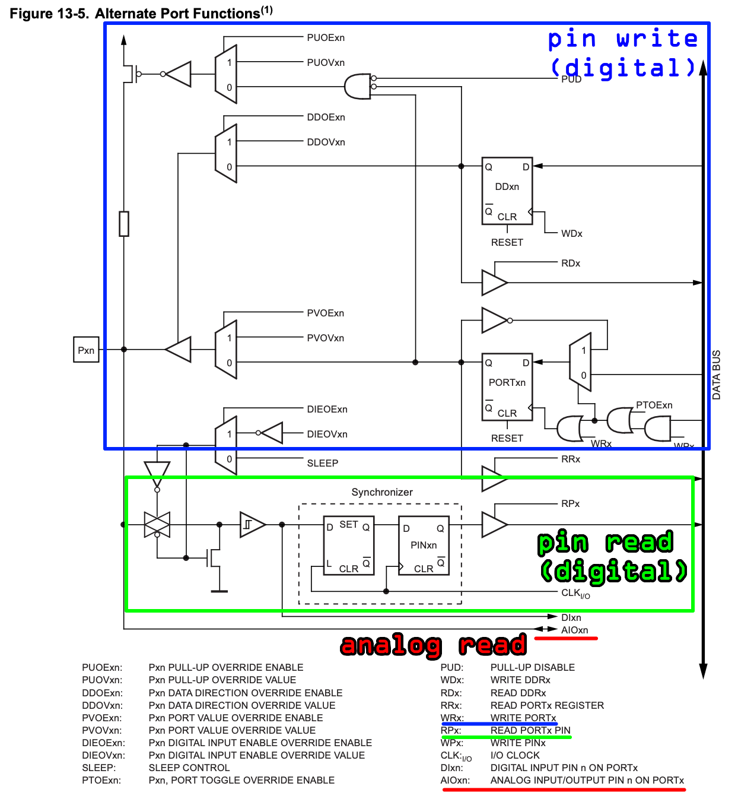

# 0005-light-switch

Learn how to read an input signal and use basic conditional statements.

## Task

Read the switch's state by configuring the pin (analog pin 3) as an input, and control an LED with the switch.

## Explanation

Okay, first of all, this can be confusing. Are we going to read analog signals? No! The switch can be `on` or `off`, left or right, it clearly produces a digital signal! But here's the catch. All analog pins are digital pins at the same time! 



To save space, almost every pin has more, than one function, and you can configure, how would you like to use it. Except power, every pin can work as a GPIO, or General Purpose Input Output. This is how we used it so far: general purpose output - connect (drive) the pin to power (5V) or ground (0V). Instead of having dedicated input and output pins, you can configure a pin to be either an `INPUT` or `OUTPUT`.

Some pins can also read analog signals, others can drive an RC servo, or communicate with other devices via UART, SPI, I²C, CAN, and many more! It depends on the microcontroller and the pin. To demonstrate this, the switch is connected to the `A3` pin. You will have to configure it just like the previous digital pins, just write a different name.

### Step 1: basic light switch

In the `setup()` function, configure pin `10` as `OUTPUT`, and pin `A3` (Analog 3) as `INPUT`.

Now read the state of the `A3` pin with the `digitalRead()` function and store the value! We learned about variables. The `HIGH` state is just the number 1, `LOW` is 0. We can store the result (return value) of the `digitalRead()` function in an integer `int` variable. (just don't forget to give a meaningful name to variables, no one will know what `x` or `a` stores)

``` C++
int switchState = digitalRead(A3);
```

We can use this variable's value in the `digitalWrite()` function too! Try writing this state to LED 1 on pin 10:

``` C++
digitalWrite(10, switchState);
```

Just for practice's sake, write this in the `setup()` function. Now if the switch is in the left position, the LED will turn off after a reset. In the right position, the LED will be on after a reset.

### Step 2: ligth switch without restart

The previous example seems pointless. We can check the switch state anytime, not just once after a reset!

Right, move the pin read-write code to the `loop()`. If you don't add any `delay()`, flipping the switch will immediately turn the LED on or off! Lovely!

### Step 3: inverted ligth switch

Let's have an annoying real-world task: adjust our code based on (seemingly) dumb requests! Someone made a mistake, and we have to correct it in our code. Turn on the LED when the switch is in its left position, and turn the LED off when it's in the right position. The exact opposite what our code does!

Last minute changes in the requirements? Wrong datasheet version? Manufacturer stopped making a part and have to use something different? No matter what happened, boss said You have to modify the code. How it's done?

We can either write the "opposite" value directly with `digitalWrite()`, but that's not universal enough. When A happens, we have to do X. Otherwise, we have to do Y. X and Y can be as complex as possible, so we have to leave room for that.

Programs have **conditionals**, otherwise they would do the same thing over and over. They control the flow of the program. We can either turn on or off some code with the `if` statement, or make an "A or B" decision by adding the `else` keyword. Our previous theoretical example would look like this:

``` C++
// if A happens
if(A) {
    // do X
    X();
}
// otherwise
else
{
    // do Y
    Y();
}
```

The condition is A, in our example the button's state. Or to be precise, the value of `switchState`. We have to turn the LED off, when it's equal to `HIGH`. When it's not `HIGH` (aka. `LOW`), turn the LED on. Modify the condition!

``` C++
if(switchState == HIGH) {
    X();
}
else
{
    Y();
}
```

We can read it as "if the value of switchState equals to HIGH". But based on our hardware configuration, it means "if the switch is in the right position"! That's the real meaning of that line.

So "if the switch is in the rigth position", to turn the LED off, aka. "write LOW to pin 10".

``` C++
if(switchState == HIGH) {
    digitalWrite(10, LOW);
}
else
{
    Y();
}
```

Finish the sentence: "otherwise turn the LED on", or "otherwise write HIGH to pin 10".

``` C++
if(switchState == HIGH) {
    digitalWrite(10, LOW);
}
else
{
    digitalWrite(10, HIGH);
}
```

### Final step: same, but different

Can we do the other way around? Absolutely! We can check if the switch's value is `LOW`, just don't forget to adjust the written values:

``` C++
if(switchState == LOW) {
  digitalWrite(10, HIGH);
}
else {
  digitalWrite(10, LOW);
}
```

Last but not least: the professionals know why this method is safer! How? We'll learn about that later, but here's a little teaser:

``` C++
if(switchState) {
  digitalWrite(10, LOW);
}
else {
  digitalWrite(10, HIGH);
}
