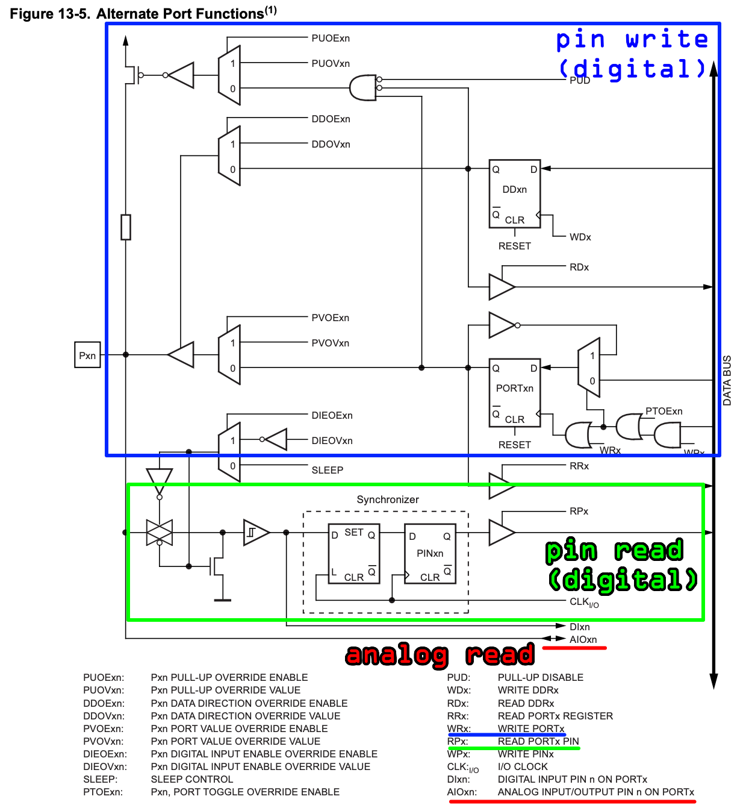

# 5. Lecke: Kapcsoló olvasása és döntéshozatal (`if` / `else`) 🎚️

Eddig a mikrovezérlőd csak *beszélt* (kimeneti jeleket küldött a LED-eknek). Ma megtanul *figyelni* is! Kiolvassuk a panelon lévő fizikai tolókapcsoló állását, és ráveszünk a kódodat, hogy reagáljon rá.

## 🎯 A küldetésed
Olvasd ki az `A3`-as analóg lábra kötött kapcsoló állapotát, és feltételes elágazások (`if` / `else`) segítségével vezéreld a `10`-es lábon lévő LED-et!

---

## 🧠 Hogyan működik?

### Várjunk csak – miért van egy kapcsoló *analóg* lábon (`A3`)?!
Szuper észrevétel! Egy tolókapcsolónak csak két állása van: **BAL** (`KI` / `LOW`) vagy **JOBB** (`BE` / `HIGH`). Ez tisztán **digitális** jel! Akkor miért az `A3` (*Analog 3*) lábra van kötve?



Íme egy fontos hardveres kulisszatitok: **ennek a mikrovezérlőnek minden analóg lába egyben teljes értékű digitális GPIO láb is!** Mivel a chipek aprók, szinte minden láb több funkciót is ellát, hogy helyet spóroljanak. Attól függően, hogyan állítod be őket kódból, képesek analóg feszültséget mérni, szervomotort vezérelni, szenzorokkal beszélgetni (UART, SPI vagy I²C buszon), vagy egyszerű digitális be- és kimenetként működni.

Szóval az `A3`-at pontosan úgy kezeled, mint bármelyik digitális lábat – csak szám helyett az `A3` nevet írod be!

### 1. lépés: A kapcsoló kiolvasása egyszer, a `setup()`-ban
Állítsuk be a `10`-es lábat kimenetnek (`OUTPUT`), az `A3`-at pedig bemenetnek (`INPUT`)! Ezután a `digitalRead(A3)` függvénnyel megnézzük, hogy a kapcsoló tápfeszültséget kap-e (`HIGH`, ami `1`-nek felel meg) vagy földre van húzva (`LOW`, ami `0`), és az eredményt elmentjük egy változóba:

```cpp
void setup() {
  pinMode(10, OUTPUT);
  pinMode(A3, INPUT);

  int switchState = digitalRead(A3);
  digitalWrite(10, switchState);
}

void loop() {
}
```
Próbáld ki! Billentsd a kapcsolót jobbra, és nyomd meg a **Reset** gombot a panelon – a LED világít. Billentsd balra, és nyomj **Resetet** – a LED sötét marad.

### 2. lépés: Élő villanykapcsoló (Reset nélkül!)
Elég fura lenne egy olyan villanykapcsoló a falon, ami után mindig újra kell indítani a házat, nem igaz? Tegyük át a `digitalRead()` és `digitalWrite()` sorokat a `loop()`-ba, hogy a vezérlő másodpercenként több ezerszer ellenőrizze a kapcsolót:

```cpp
void setup() {
  pinMode(10, OUTPUT);
  pinMode(A3, INPUT);
}

void loop() {
  int switchState = digitalRead(A3);
  digitalWrite(10, switchState);
}
```
Most kattintgasd ide-oda a kapcsolót – a LED azonnal követi!

### 3. lépés: Fordított működés `if` / `else` segítségével
Képzeld el, hogy odajön hozzád a hardveres csapattársad: *"Bocs, fejjel lefelé forrasztottuk be a kapcsolót! Meg tudnád oldani kódból, hogy **BAL** állásban (`LOW`) világítson a LED, **JOBB** állásban (`HIGH`) pedig aludjon ki?"*

A valódi fejlesztői munkában az ilyen utólagos módosítások mindennaposak – és sokkal gyorsabb kódból megoldani, mint átforrasztani egy egész szériát! Ahhoz, hogy a programunk döntéseket hozzon, **feltételes elágazásokat** (`if` – ha, `else` – különben) használunk:

```cpp
void setup() {
  pinMode(10, OUTPUT);
  pinMode(A3, INPUT);
}

void loop() {
  int switchState = digitalRead(A3);

  // Figyeld a DUPLA egyenlőségjelet (==), amivel összehasonlítunk!
  if (switchState == HIGH) {
    digitalWrite(10, LOW);  // Ha JOBBRA áll -> LED KI
  }
  else {
    digitalWrite(10, HIGH); // Különben (ha BALRA áll) -> LED BE
  }
}
```

> **Vigyázz az `=` és a `==` különbségére!** Az egy darab `=` *értéket ad* (betesz egy adatot a változóba), míg a dupla `==` *kérdést tesz fel* („egyenlő ez a két érték?”). Ezt összekeverni a C++ programozók egyik legklasszikusabb hibája!

### Utolsó lépés: Ugyanaz a logika, kicsit másképp
Megfordíthatjuk a feltételt is, és vizsgálhatjuk először a `LOW` állapotot:

```cpp
if (switchState == LOW) {
  digitalWrite(10, HIGH);
}
else {
  digitalWrite(10, LOW);
}
```
Sőt, mivel a C++ az `1`-et (`HIGH`) **igaznak**, a `0`-t (`LOW`) pedig **hamisnak** tekinti, a rutinos fejlesztők gyakran csak ennyit írnak: `if (switchState)`!

---

## 🛠️ Hardveres ellenőrzés és Házi feladat
* **Forrasztási szemle:** Ha a kapcsoló billentésére egyáltalán nem reagál a LED, nézd meg a tolókapcsoló alatti forrasztási pontokat, nem vált-e el valamelyik láb!
* **Kihívás (Beszéld át a tanároddal, ha elakadsz!):** Most egyetlen LED-et kapcsolgatsz. Hogyan tudnád átírni az `if` / `else` blokkot úgy, hogy **BAL** állásban a `4`-es LED világítson, **JOBB** állásban pedig a `11`-es?
